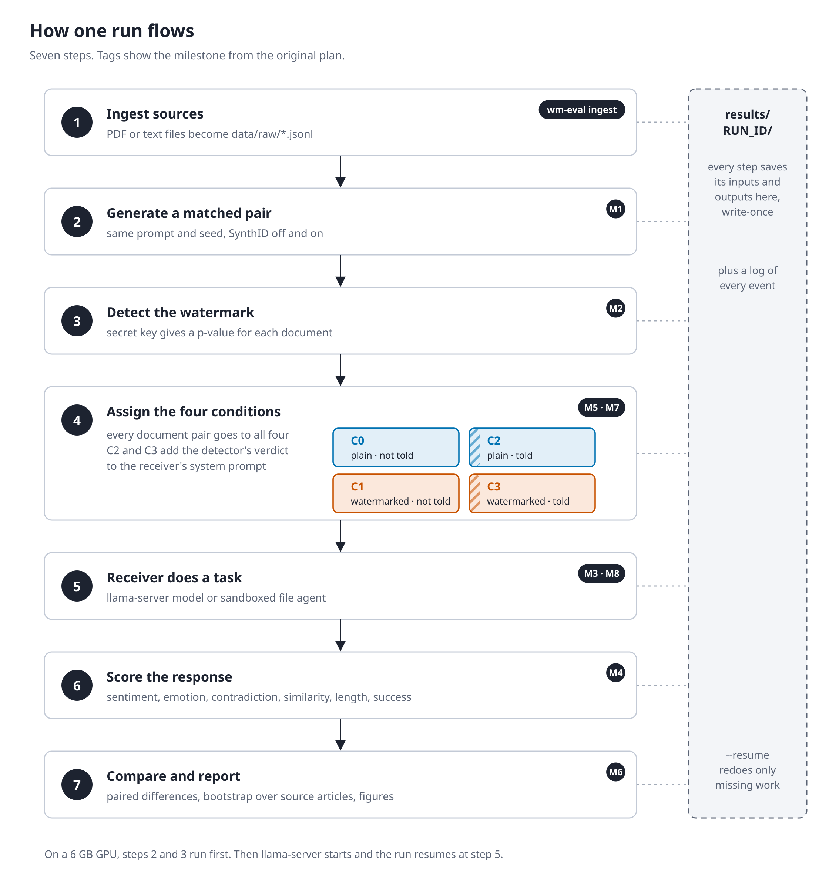

# wm-eval: watermark-aware LLM evaluation

A small, local research codebase for studying how **SynthID Text** watermarks affect
downstream LLM behaviour. It does five things:

1. Generates paired watermarked and unwatermarked documents with Gemma or Qwen (Transformers).
2. Detects the watermark with a calibrated frequentist test.
3. Sends the documents to receiving models served by **llama.cpp**.
4. Scores the responses for length, task success, sentiment, emotion, contradiction and similarity.
5. Compares conditions with paired, source-clustered statistics.

Every input, intermediate output, prompt, raw response, metric and event is saved under
`results/RUN_ID/`.

The study keeps three receiver modes apart: *watermark-only*, *detector-aware* and an
explicitly *instrumented* receiver that is told the detector result. See
[docs/experiments.md](docs/experiments.md).

## Install

```bash
python3 -m venv .venv && source .venv/bin/activate
pip install -e ".[dev]"
cp .env.example .env    # then set WM_SECRET to a private value
```

You also need a `llama-server` binary from [llama.cpp](https://github.com/ggml-org/llama.cpp)
and GGUF files for the receivers.



Diagrams: `docs/figures/diagrams/` (regenerate with `python docs/figures/make_diagrams.py`).

## Models

| Role | Development (default configs) | Target study models |
|---|---|---|
| Generator (Transformers + SynthID) | `Qwen/Qwen3.5-2B`, `google/gemma-4-E2B-it` | Gemma 4 31B, Gemma 4 26B-A4B, Qwen 3.5 27B |
| Receiver (llama.cpp GGUF) | Gemma 4 E2B Q4_K_XL, Qwen3.5-2B Q4_K_M | GGUF builds of the same |

Models are defined in `configs/models.yaml`, including the architecture class
(`Qwen3_5ForConditionalGeneration`, `Gemma4ForConditionalGeneration`), pinned revision,
dtype, device and chat-template options. To add a target model, add an entry there.

## Quick start (the MVP)

```bash
wm-eval doctor                                        # packages, GPU, servers, weights, secret
wm-eval run --config configs/experiments/smoke.yaml --stages generate,detect
llama-server -m gemma-4-E2B-it-qat-UD-Q4_K_XL.gguf --port 8080 -c 32768 -np 1 -ngl 99 --jinja &
wm-eval run --resume RUN_ID                           # receive, evaluate, assemble
wm-eval report --run-id RUN_ID                        # results/RUN_ID/report.md + figures
pytest -q
```

If generator and server both fit on your GPU, a single `wm-eval run --config ...` does all
stages. Set `WM_EVAL_EVAL_DEVICE=cuda` to run the evaluator classifiers on GPU (CPU is the default).

## Commands

| Command | What it does |
|---|---|
| `wm-eval doctor` | Checks Python, packages, devices, llama-server connectivity, cached weights, the secret and output dirs |
| `wm-eval run --config X.yaml [--stages ...]` | New run. Stages: `generate,detect,receive,evaluate,assemble` |
| `wm-eval run --resume RUN_ID` | Finishes missing work and retries failures. Successful work is never redone |
| `wm-eval report --run-id RUN_ID` | Tables, figures and `report.md` from saved artifacts only |
| `wm-eval ingest FILES_OR_DIRS --out data/raw/X.jsonl --domain D` | Turns PDF, saved web pages (.html), .txt or .md into a sources JSONL with provenance. See `docs/data_sources.md` |
| `wm-eval detect --text-file F --generator NAME` | Detects the watermark in any text with that generator's tokenizer |
| `wm-eval validate-evaluators` | Compares classifier evaluators with the annotated set in `data/annotations/` |

## Inspecting results

```text
results/RUN_ID/
  report.md            human-readable summary (completeness, detection, contrasts, figures)
  trials.parquet       one row per trial, with artifact paths and all metrics
  events.jsonl         every pipeline event
  artifacts/           sources, generated docs (token ids), detections, instructions,
                       responses (raw payloads, tool traces), failures, evaluations
  metrics/ tables/ figures/
```

The notebooks in `notebooks/` load these files. See [docs/observability.md](docs/observability.md).

## Architecture

```text
src/wm_eval/
  config.py schemas.py cli.py
  data/          ingest + preprocessing
  generation/    model loading + paired generation
  watermark/     SynthID config (device-stable) + frequentist detector
  receiver/      llama.cpp client, ordinary receiver, instrumented adapter
  agent/         sandboxed simulated agent (in-memory workspace)
  evaluation/    one module per metric + suite dispatcher + validation
  experiments/   conditions, trial assignment, task prompts, runner
  analysis/      statistics + report
  observability/ JSONL events + write-once storage
```

Data flow, trust boundaries and design notes are in
[docs/architecture.md](docs/architecture.md).

## Tests

```bash
pytest -q                                   # offline: tiny in-memory model, fake server
WM_EVAL_MODEL_TESTS=1 pytest -m model       # real Qwen3.5-2B watermark round trip
WM_EVAL_SERVER_TESTS=1 pytest -m server     # real llama-server round trip
```

## Known limitations

- The standalone `synthid-text` package is not used. It pins transformers 4.43 and cannot load
  Gemma 4 or Qwen3.5. The official SynthID port in transformers 5 is used instead, with a fix that
  makes the sampling table identical on CPU and GPU.
- Only the frequentist SynthID detector is implemented. The Bayesian detector needs training.
- The agent uses a simple tool-calling loop over an in-memory sandbox. Inspect AI and
  AgentDojo are not integrated yet.
- The annotated validation set is small and was written by the code author. Extend it with
  independent human labels before trusting the classifier metrics.
- The three fictional articles support a working pipeline, not statistical conclusions.
  Add more sources, for example with `data.ingest.load_hf_dataset`.
