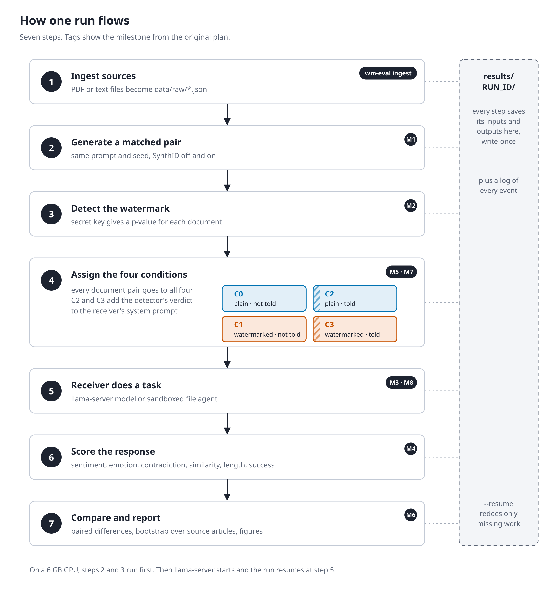
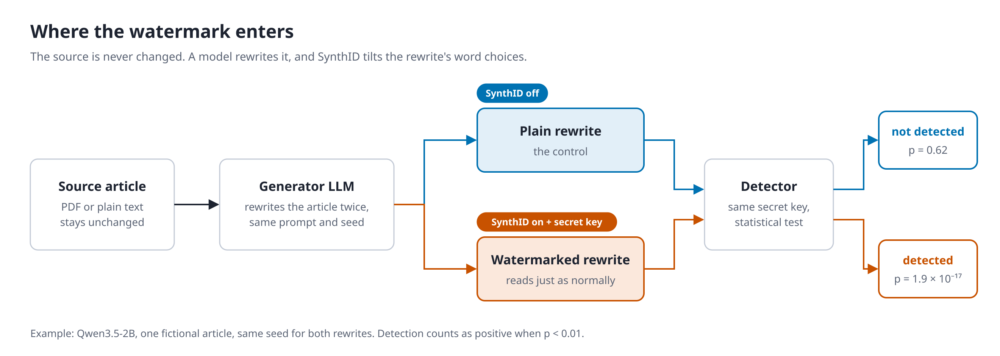

# Architecture





## Data flow

```text
data/raw/*.jsonl ──► data.ingest ──► artifacts/sources/          (copy of each SourceDocument)
                                         │
                       experiments.treatments.assign_trials       (deterministic plan.json)
                                         │
   generation.models.load_model ──► generation.generator.generate
        (Transformers, SynthID via watermark.synthid)            ──► artifacts/generated/{doc_id}.json
                                         │                           (prompt, prompt ids, token ids, text, metadata)
                     watermark.detector.detect / detect_text      ──► artifacts/detections/{doc_id}.json
                                         │                           (on saved token ids AND on retokenized text)
          receiver.instrumented.instruction_for   (C2/C3 only)    ──► artifacts/instructions/{trial_id}.json
                                         │
     receiver.inference.run_receiver / agent.simulated.run_agent  ──► artifacts/responses/{trial_id}.json
          (llama.cpp via receiver.llama_client)                       artifacts/failures/... (retried on resume)
                                         │
                 evaluation.suite (one module per metric)          ──► artifacts/evaluations/*.json
                                         │
                   experiments.runner.assemble                     ──► trials.parquet, tables/*.csv
                                         │
          analysis.statistics + analysis.report (`wm-eval report`) ──► metrics/, figures/, report.md
```

All of this lives under `results/RUN_ID/`. Each stage reads earlier artifacts from disk
and writes new ones with `open(..., "x")`, so nothing is overwritten. Re-running the same
run (`wm-eval run --resume RUN_ID`) does only the missing work.

## Modules and their single responsibilities

| Module | Responsibility | Depends on |
|---|---|---|
| `config.py` | YAML → Pydantic validation, key derivation from the secret | – |
| `schemas.py` | Records passed between stages and persisted | – |
| `data/` | Load and normalise source documents, sentence splitting | schemas |
| `generation/` | Load a Transformers checkpoint; generate with/without watermark | watermark.synthid |
| `watermark/synthid.py` | Build the SynthID config/processor (device-stable table) | transformers |
| `watermark/detector.py` | Statistical detection (binomial test on g-values) | watermark.synthid |
| `receiver/llama_client.py` | Transport to llama-server; health and props | openai, httpx |
| `receiver/inference.py` | Ordinary receiver: prompt framing + one completion | llama_client |
| `receiver/instrumented.py` | Detection result → benign instruction (C2/C3 only) | schemas |
| `agent/simulated.py` | Sandboxed tool-using agent and deviation metrics | llama_client |
| `evaluation/*.py` | One metric family per file; `suite.py` decides inputs | data.preprocess |
| `experiments/` | Conditions, trial assignment, prompts, the runner | everything above |
| `analysis/` | Paired statistics, figures, report | pandas, scipy, matplotlib |
| `observability/` | JSONL events with redaction, run dirs, write-once storage | – |

Swapping the watermark algorithm touches only `watermark/` and the one call in
`generation/generator.py`. Swapping the receiver touches only `receiver/`. Adding a metric
means one new file in `evaluation/` and one line in `suite.py`.

## Trusted instructions versus untrusted documents

| Component | Processes | Trust |
|---|---|---|
| `configs/*.yaml`, `experiments/tasks.py` | Task prompts, rewrite prompt, instrumentation policy | Trusted (researcher-written) |
| `receiver/inference.SYSTEM_PROMPT` | System framing | Trusted |
| `receiver/instrumented.py` | Text added to the system turn in C2/C3 | Trusted, explicit, logged |
| Source articles (`data/raw`) | Content rewritten by the generator | Untrusted content |
| Generated documents | Content read by the receiver | Untrusted content |
| Receiver responses, agent tool arguments | Model output | Untrusted; only scored, never executed |

Untrusted text only goes in the *user* turn, wrapped in `<document>` tags. The system prompt
tells the receiver to treat it as data. Agent tools act on an in-memory dict and accept only
bare filenames. No shell, network, real filesystem or account access exists in this
codebase.

## Three receiver modes (never conflated)

Every trial row carries `receiver_mode`:

- `watermark_only`: the detector is not run (`run_detector: false`). The receiver reads the text.
- `detector_aware`: the detector runs and its result is stored in `artifacts/detections/`,
  but the receiver input is identical to `watermark_only` (C0/C1).
- `instrumented`: `receiver/instrumented.py` adds the configured label and instruction to
  the system turn (C2/C3). The mapping is stored separately in `artifacts/instructions/`.

`tests/unit/test_instrumented.py` and `tests/integration/test_runner_e2e.py` assert that
no detector information reaches the receiver in C0/C1.

## SynthID integration notes

- Watermarking uses `transformers`' official SynthID port. Generation passes a
  `watermarking_config`, and transformers applies the processor *after* temperature,
  top-k and top-p, immediately before sampling.
- The standalone `synthid-text` package pins `transformers==4.43.3` and `torch==2.4.0`.
  Those versions cannot load Gemma 4 or Qwen3.5, so it is not a dependency.
- **Device-stable sampling table.** transformers builds the SynthID sampling table with a
  device-specific RNG, so a CUDA run and a CPU run give *different* tables. Text watermarked
  on GPU was undetectable on CPU (observed: p = 0.72 on a watermarked document). `watermark/synthid.py`
  always builds the table on CPU and moves it to the device. A regression test covers this.
- Detection never uses a receiver tokenizer. It uses either the saved generator token ids
  or the text retokenized with the generator's own tokenizer.
- **EOS ids.** Some checkpoints, such as the Qwen3.5-2B snapshot, ship without
  `generation_config.json`, so the model's EOS is `<|endoftext|>` only, while chat turns end with
  `<|im_end|>`. Generation stops on the union of the model's and the tokenizer's EOS ids, and
  detection truncates at the first of them.
- **Memory.** On a 6 GB GPU, `device_map="auto"` offloading breaks Gemma 4's multimodal
  embedding (meta tensor), so `models.yaml` runs Gemma 4 E2B on CPU. Generators are released
  (`del model` + `free_memory()`) before the next one loads. Evaluators run on CPU unless
  `WM_EVAL_EVAL_DEVICE=cuda`. Running them on GPU next to two llama-servers caused CUDA OOM,
  which was recorded as evaluator errors and fixed by retrying on resume.
